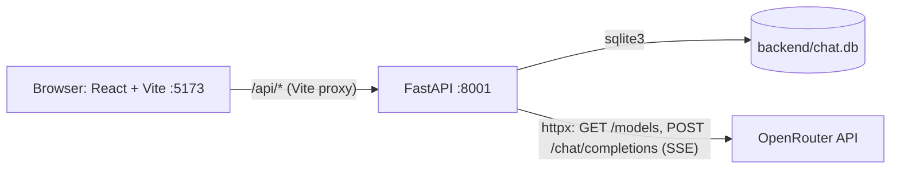
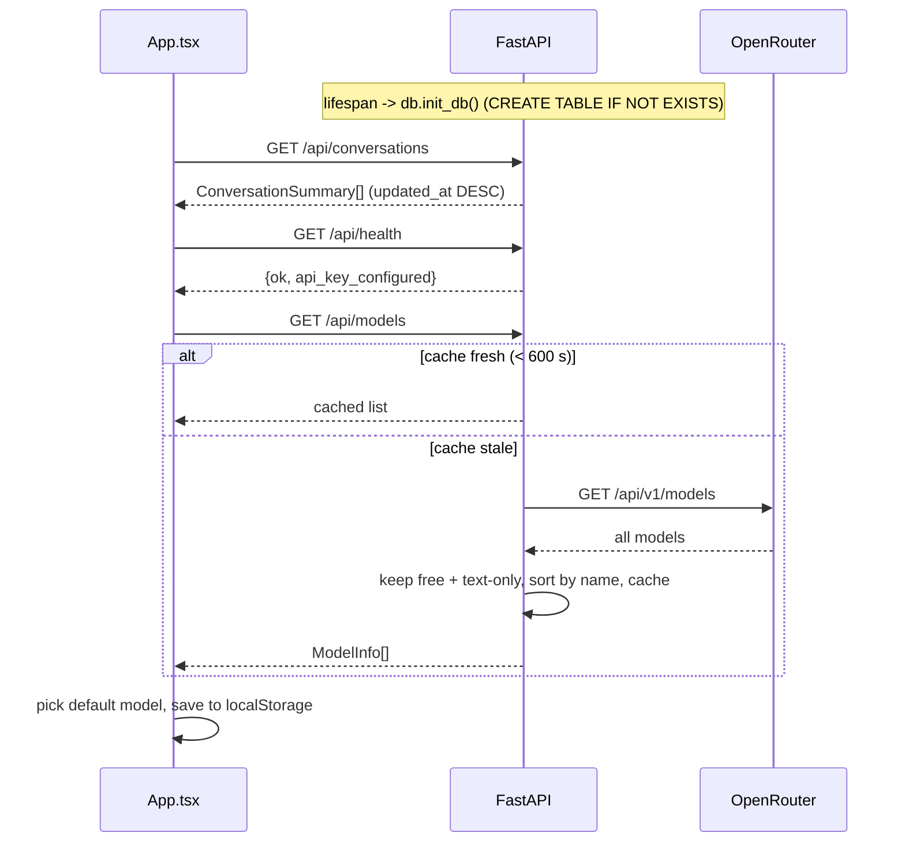
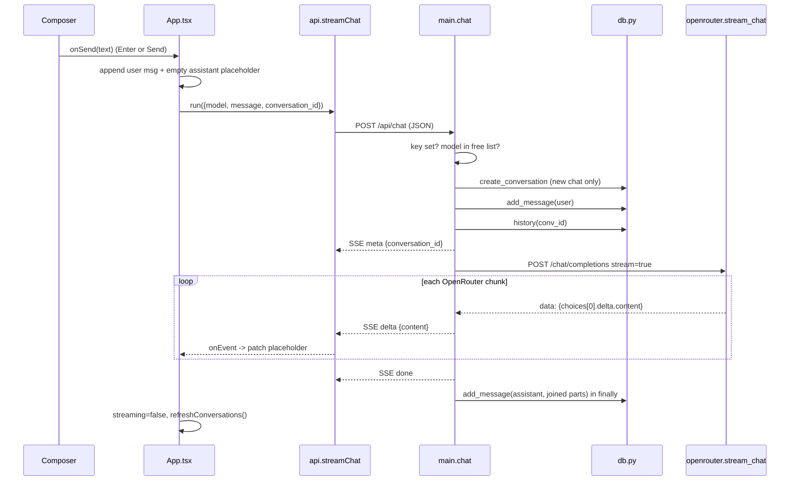
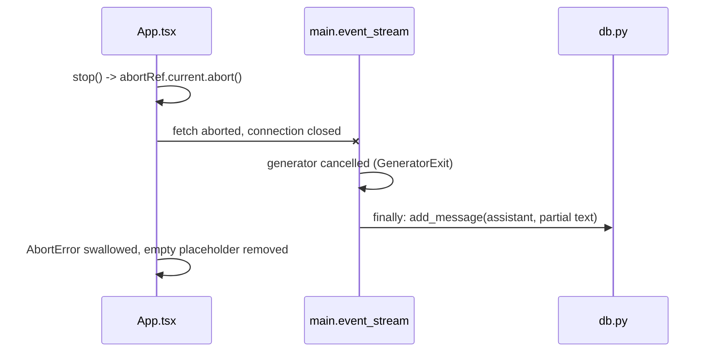

# ChatGPT Clone — Technical Workflow Document

Sep 26, 2026 · Raveendra Battala · Online version: https://claude.ai/code/artifact/d23f87cb-22e5-4de1-bf8d-57f6ea4b9db1

## 1. Overview and architecture

The app is a three-tier ChatGPT clone: a React UI calls a FastAPI backend, which stores chats in SQLite and forwards requests to OpenRouter using only free models. The OpenRouter API key never leaves the backend.

In development, Vite proxies every `/api/*` call to `http://localhost:8001` (override with `API_PROXY_TARGET`). In production, set `VITE_API_URL` and `CORS_ORIGINS`, or serve `frontend/dist` from the same origin.

### Module map

| Layer | File | Responsibility |
| --- | --- | --- |
| Frontend | `src/App.tsx` | App state, orchestrates every workflow (send, stop, regenerate, history, settings) |
| Frontend | `src/api.ts` | REST helpers (`api.*`) and the SSE stream reader `streamChat()` |
| Frontend | `src/components/Composer.tsx` | Auto-growing input, Enter to send, Send/Stop button |
| Frontend | `src/components/ChatMessage.tsx` | Markdown rendering, code copy, message copy, regenerate button |
| Frontend | `src/components/Sidebar.tsx` | Date-grouped history, rename, delete, settings and theme buttons |
| Frontend | `src/components/ModelSelector.tsx` | Searchable free-model dropdown |
| Frontend | `src/components/SettingsModal.tsx` | Custom instructions (system prompt) editor |
| Frontend | `src/types.ts` | Shared types: `Message`, `Conversation`, `ModelInfo`, `StreamEvent` |
| Backend | `app/main.py` | FastAPI app, CORS, routes, chat orchestration and SSE output |
| Backend | `app/openrouter.py` | Free-model listing and cache, streaming client for OpenRouter |
| Backend | `app/db.py` | SQLite schema and all queries |
| Backend | `app/config.py` | Loads `backend/.env` then `temp/.env`; exposes settings |

## 2. App startup workflow

On first render, `App.tsx` fires three independent requests in one `useEffect`: history, health and the free-model list. The backend initialises the SQLite schema once, in the FastAPI `lifespan` hook, before serving requests.

1. **Health.** `GET /api/health` returns `api_key_configured`. If false, the UI shows a red banner asking for `OPENROUTER_API_KEY`.
2. **Model list** (`openrouter.list_free_models`). A model is kept when both checks pass:
   - `_is_free`: the id ends in `:free`, or `pricing.prompt` and `pricing.completion` are both 0.
   - `_is_text_chat`: input modalities include text and output modalities are exactly `["text"]` (drops audio and image generators).
3. **Cache.** The filtered list is held in the in-process `_models_cache` for `MODELS_CACHE_TTL` (600 s default). A restart clears it.
4. **Default model.** The UI keeps the model saved in `localStorage` if it is still in the list. Otherwise it picks the first match from `PREFERRED`: `openrouter/free`, then deepseek, llama-3.3, gemini, qwen, mistral, else the first model.
5. **History.** The sidebar renders the conversation list, grouped by date (section 6).

## 3. Send message and streaming chat

A message travels Composer → `App.send` → `App.run` → `streamChat` → `POST /api/chat`, and tokens stream back as Server-Sent Events that the UI appends to one placeholder bubble. The backend saves the user message before calling OpenRouter and the assistant reply after the stream ends.

### Frontend steps

1. **Composer** (`Composer.tsx`). Enter submits and Shift+Enter adds a newline; IME composition is ignored. The textarea grows to 200 px. Empty text, no model or an active stream blocks sending.
2. **`App.send(text)`** appends `{role:'user'}` locally, then calls `run({model, message, conversation_id: activeId})`. `activeId` is null for a new chat.
3. **`App.run(params)`** adds an empty assistant placeholder with a local id and sets `streaming=true`. It creates an `AbortController` (kept in `abortRef`) and adds `system_prompt` from settings when set.
4. **`streamChat`** (`api.ts`) POSTs JSON and reads `res.body` with a `ReadableStream` reader and `TextDecoder`. It splits the buffer on blank lines (`\n\n`) and parses each `data:` line as a `StreamEvent`.
5. **Event handling** in `run`:
   - `meta`: sets `activeId`, so a new chat gets its server id before any text arrives.
   - `delta`: appends `content` to the placeholder. React re-renders, and `ChatMessage` shows a blinking cursor while `streaming`.
   - `error`: shows a red error box, or appends a warning quote if some text already arrived.
6. **Cleanup** (`finally`): removes the placeholder if it is still empty, clears `streaming` and `abortRef`, and reloads the sidebar list.
7. **Rendering** (`ChatMessage.tsx`). `react-markdown` renders with `remark-gfm` (tables, task lists) and `rehype-highlight` (syntax colours). `CodeBlock` adds a language label and a Copy code button.
8. **Auto-scroll.** The message list sticks to the bottom only while the user is within 80 px of it, so scrolling up during a stream is not interrupted.

### Backend steps (`main.chat`)

1. **Guards.** Returns 503 if `OPENROUTER_API_KEY` is empty. Returns 400 if `model` is not in `list_free_models()`: the gateway only forwards free models.
2. **Conversation.** With no `conversation_id`, it creates one titled by `_make_title` (first message, whitespace collapsed, cut to 50 chars). An unknown id returns 404. Empty messages return 400.
3. **Persist user turn.** `db.add_message(conv_id, 'user', message)` also bumps `updated_at`.
4. **Build context.** Messages = optional system prompt (request value, else `DEFAULT_SYSTEM_PROMPT`) + the full stored history, oldest first.
5. **Stream.** `event_stream()` yields `meta`, then one `delta` per OpenRouter token chunk, then `done`. The response is `text/event-stream` with `Cache-Control: no-cache` and `X-Accel-Buffering: no`, so proxies do not buffer.
6. **OpenRouter client** (`stream_chat`). It sends `Authorization`, `HTTP-Referer` and `X-Title` headers. Timeouts are 15 s connect and 120 s read. It skips `:` keep-alive comments, stops on `data: [DONE]`, and raises `OpenRouterError` on non-200 or in-stream `error` chunks.
7. **Persist assistant turn.** In `finally`, the joined parts are saved with the model id when any text arrived. This runs on success, on error and on client disconnect.

## 4. Stop generation

Stop aborts the browser's fetch; the backend notices the dropped connection and still saves whatever text had streamed. Nothing extra is sent to the server.

1. While `streaming` is true, the Composer shows a Stop button that calls `App.stop()`.
2. `abortRef.current?.abort()` rejects the pending fetch or `reader.read()` with `AbortError`. `run` ignores that error, so no error bubble appears.
3. Starlette cancels the `event_stream` generator when the client disconnects. Its `finally` block saves the partial reply, so reopening the chat shows the same text.
4. `stop()` is also called by New chat and by opening another conversation, so a stream never writes into the wrong chat.

## 5. Regenerate

Regenerate replaces the last assistant reply: the UI drops it locally, and the backend deletes it from SQLite before streaming a new one from the same history.

1. **Button.** `ChatMessage` shows Regenerate only on the last message, when it is an assistant reply, no stream is running and the chat has a server id.
2. **`App.regenerate()`** removes the last message from state if its role is `assistant`. It then calls `run({model, conversation_id: activeId, regenerate: true})` with no message text.
3. **Backend.** With `regenerate: true`, `main.chat` checks the conversation exists (404 if not). It calls `db.delete_last_assistant_message`, which deletes the newest row only when its role is `assistant`. No user message is added.
4. **Stream.** Context is rebuilt from the remaining history and streamed exactly as in section 3. The current model is used, so switching models then regenerating compares models on the same prompt.

## 6. Conversation history

Every history action is a single REST call followed by `refreshConversations()`, which re-fetches the list so the sidebar always mirrors SQLite.

| Action | UI trigger (file) | Frontend call | Backend route → DB function | Result in UI |
| --- | --- | --- | --- | --- |
| List | App mount, and after every stream, rename or delete (`App.tsx`) | `api.conversations()` | `GET /api/conversations` → `list_conversations` (ORDER BY `updated_at` DESC) | Sidebar grouped Today, Yesterday, Previous 7 days, Previous 30 days, Older by `updated_at` |
| Open | Click a history item (`Sidebar.tsx`) | `api.conversation(id)` | `GET /api/conversations/{id}` → `get_conversation` (row + messages by `created_at`) | Messages replace the thread; model switches to the chat's model if still free; 404 clears the thread |
| New chat | New chat button or top-bar plus (`Sidebar.tsx`, `App.tsx`) | none | none; the row is created on the first send | Stream stopped, `activeId` null, empty state with suggestion cards |
| Rename | Pencil icon, then Enter or blur; Escape cancels (`Sidebar.tsx`) | `api.rename(id, title)` | `PATCH /api/conversations/{id}` → `rename_conversation`; title 1–200 chars | New title in sidebar |
| Delete | Trash icon + browser confirm (`Sidebar.tsx`) | `api.remove(id)` | `DELETE /api/conversations/{id}` → `delete_conversation`; messages removed by `ON DELETE CASCADE` | Row gone; if it was open, the view resets to New chat |
| Auto-title | First message of a new chat (`main.py`) | none | `_make_title` inside `POST /api/chat` | Title appears after the first stream ends |

On phones (width ≤ 768 px) the sidebar is an overlay with a dark scrim. Choosing a chat or New chat closes it automatically.

## 7. Model selection, settings and theme

The selected model, system prompt and theme are per-browser preferences kept in `localStorage`; the server stores only which model produced each message. All storage access is wrapped in try/catch, so the app still works when storage is blocked.

| Preference | UI | localStorage key | How it reaches the backend |
| --- | --- | --- | --- |
| Model | `ModelSelector`: dropdown with search over name and id, context size shown, closes on outside click | `model` | `model` field of every `POST /api/chat`; saved on each assistant message and as the conversation's `model` |
| Custom instructions | `SettingsModal` from the sidebar Settings button | `systemPrompt` | `system_prompt` field; empty means the server's `DEFAULT_SYSTEM_PROMPT` is used |
| Theme | Sidebar Light/Dark mode button | `theme` (first visit follows `prefers-color-scheme`) | Not sent; sets `data-theme` on `<html>`, which switches the CSS variables |

The system prompt is sent on every request and never stored in SQLite. Changing it therefore affects the next reply in any conversation, including old ones.

## 8. Error handling and rate limits

Errors raised before streaming starts come back as HTTP errors; errors from OpenRouter mid-request come back as an SSE `error` event. In both cases the UI shows a red box in the assistant bubble rather than crashing.

| Failure | Where detected | Response | What the user sees |
| --- | --- | --- | --- |
| API key missing | `main.chat` guard; `/api/health` | 503 `{detail}` | Red banner at top, plus error in the chat |
| Model not free or unknown | `main.chat` checks `list_free_models()` | 400 `{detail}` | Error bubble naming the model |
| Model list fetch fails | `/api/models` or the chat guard | 502 `{detail}` | Picker shows "Models unavailable"; send is disabled |
| Unknown conversation id | `main.chat`, GET/PATCH/DELETE routes | 404 `{detail}` | Error bubble, or empty thread when opening |
| Empty message | `main.chat` | 400 | Not reachable from the UI; the Send button is disabled |
| OpenRouter 429 (free-tier rate limit) | `stream_chat` non-200 branch | SSE `error` with a hint to retry or pick another model | Error bubble; switch model (Free Models Router recommended) and Regenerate |
| Other OpenRouter status or in-stream `error` | `stream_chat` | SSE `error` with the provider message | Error bubble, or a warning appended under the partial text |
| Network drop or timeout (120 s read) | `event_stream` generic `except` | SSE `error` "Upstream error: ..." | Same as above; partial text is still saved |

On the frontend, `api.ts` turns any non-2xx response into an `Error` using FastAPI's `detail` field. `run` shows it in the bubble unless the error is an `AbortError` from Stop.

Free OpenRouter models are shared, so 429s are common. The default model `openrouter/free` routes each request to whichever free model is available, which avoids most of them.

## 9. Data model, API and SSE contract

Two SQLite tables hold everything: `conversations` and `messages`, linked by a cascading foreign key. Timestamps are Unix seconds (REAL) and ids are UUID4 strings.

| Table | Column | Type | Notes |
| --- | --- | --- | --- |
| conversations | id | TEXT PK | UUID4 |
| conversations | title | TEXT | From `_make_title`, editable |
| conversations | model | TEXT | Last model used |
| conversations | created_at / updated_at | REAL | `updated_at` bumped on every message; drives sort order |
| messages | id | TEXT PK | UUID4 |
| messages | conversation_id | TEXT FK | `ON DELETE CASCADE`; index on (`conversation_id`, `created_at`) |
| messages | role | TEXT | `user` or `assistant` (system prompt is never stored) |
| messages | content | TEXT | Full text; partial if stopped |
| messages | model | TEXT | Model id for assistant rows, null for user rows |
| messages | created_at | REAL | Message order |

### REST endpoints

| Method | Path | Request body | Response |
| --- | --- | --- | --- |
| GET | `/api/health` | none | `{ok, api_key_configured}` |
| GET | `/api/models` | none | `[{id, name, context_length, description}]` |
| GET | `/api/conversations` | none | `[{id, title, model, created_at, updated_at}]` |
| GET | `/api/conversations/{id}` | none | Conversation + `messages[]` |
| PATCH | `/api/conversations/{id}` | `{title}` | `{ok: true}` |
| DELETE | `/api/conversations/{id}` | none | `{ok: true}` |
| POST | `/api/chat` | `{model, message?, conversation_id?, system_prompt?, regenerate?}` | `text/event-stream` |

### SSE events from `POST /api/chat`

Each event is one `data: <json>` line followed by a blank line. Order is always `meta`, then zero or more `delta`, then exactly one `done` or `error`.

| type | Fields | Meaning |
| --- | --- | --- |
| meta | `conversation_id` | Sent first; gives a new chat its id |
| delta | `content` | Next chunk of assistant text |
| done | none | Stream finished normally |
| error | `message` | OpenRouter or network failure; stream ends |

## 10. Configuration and running locally

Run `start-backend.cmd` and `start-frontend.cmd` from the project root in two terminals, then open `http://localhost:5173`. The backend script creates `backend/.venv` and installs dependencies on first run.

| Variable | Default | Used by |
| --- | --- | --- |
| `OPENROUTER_API_KEY` | none (required) | `openrouter.py` auth header; `/api/health` |
| `OPENROUTER_BASE_URL` | `https://openrouter.ai/api/v1` | All OpenRouter calls |
| `APP_URL`, `APP_NAME` | `http://localhost:5173`, `ChatGPT Clone` | `HTTP-Referer` and `X-Title` headers (OpenRouter attribution) |
| `DB_PATH` | `backend/chat.db` | `db.py` |
| `CORS_ORIGINS` | `http://localhost:5173` | CORS middleware, comma-separated |
| `DEFAULT_SYSTEM_PROMPT` | "You are a helpful assistant..." | Used when the UI sends no system prompt |
| `MODELS_CACHE_TTL` | `600` (seconds) | Free-model list cache |
| `API_PROXY_TARGET` (frontend) | auto: first of `:8001`, `:8000` whose `/api/health` answers, else `:8001` | Vite dev proxy target, chosen at dev-server startup |
| `VITE_API_URL` (frontend) | empty (same origin) | API base URL in production builds |

Backend variables load from `backend/.env` first, then from `temp/.env` at the project root; a value already set is not overwritten. Both files are gitignored. The backend runs on port 8001 because port 8000 is used by another app on the development machine.
